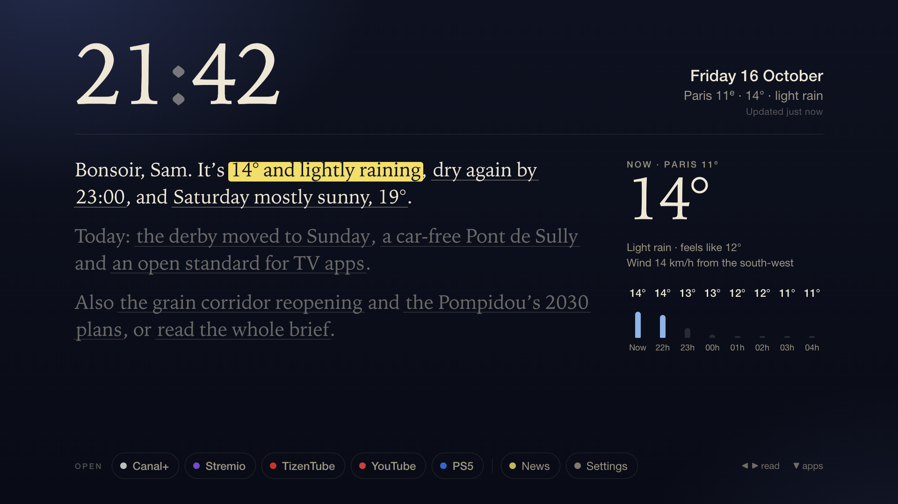
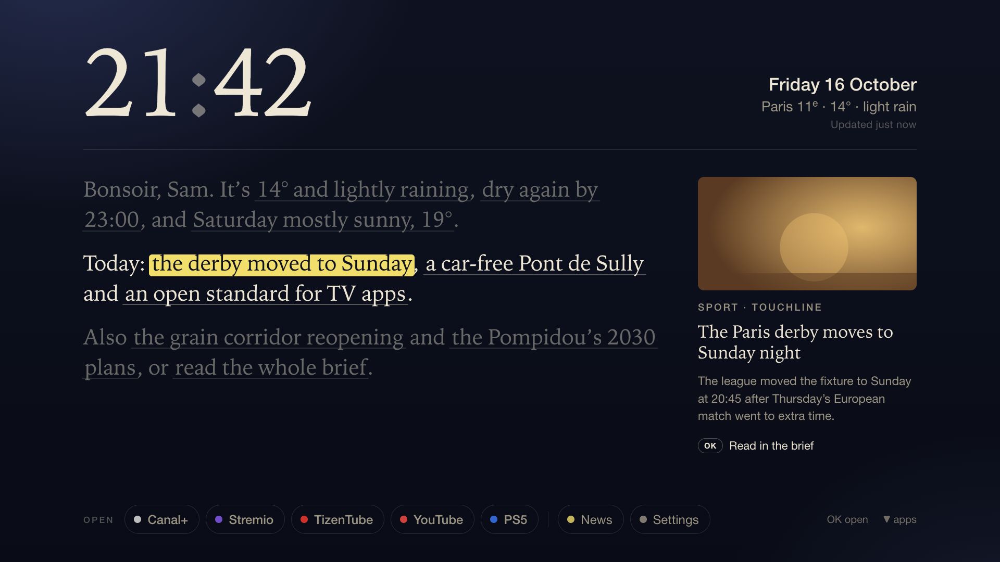
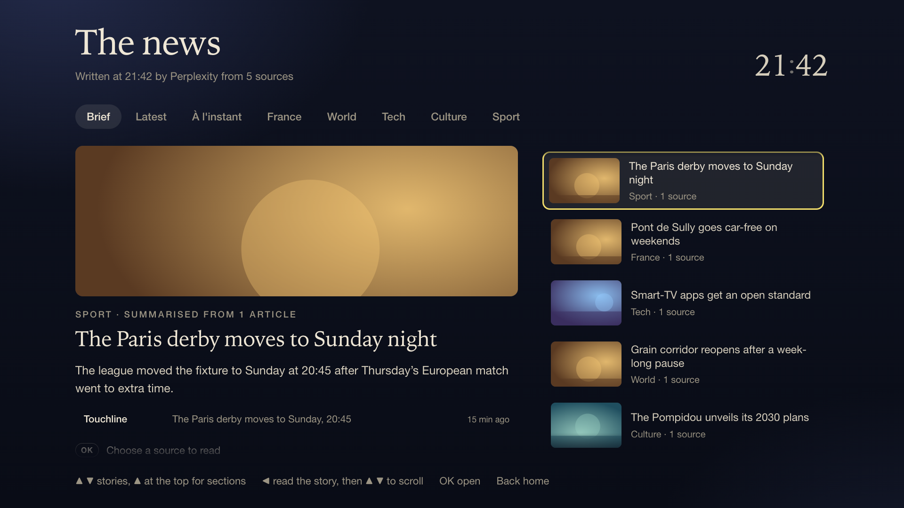
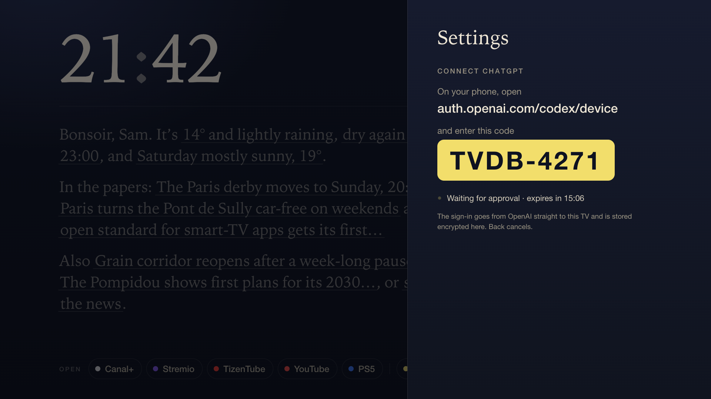
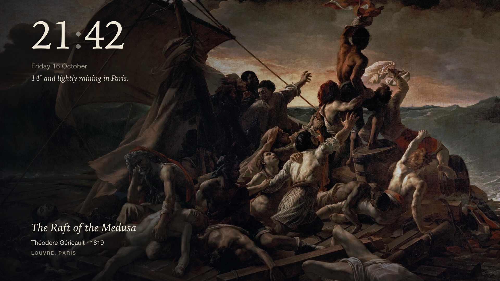

# TV Dashboard

A home screen for a Samsung Tizen TV. It opens with a short letter (the weather and the day's news, written as sentences whose phrases you can select), a margin that details whatever is focused, and a rack of apps along the bottom.

The look is the Bonsoir theme: ink-blue night, paper-coloured serif text, and a highlighter stroke that marks what the remote is pointing at, built to read from the sofa in a dim room.



| | |
| --- | --- |
|  |  |
| **Focus a phrase** and the margin explains it: a story's summary, an hourly forecast, the week ahead. | **News** groups the day's headlines by section, with an AI-written brief when ChatGPT is connected. |
|  |  |
| **Connect ChatGPT** by entering a code on your phone. The sign-in goes straight to the TV and is stored there encrypted. | **Ambient mode** turns the TV into a gallery when the remote is idle: public-domain art from ancient Egypt to Romanticism. |

<sub>Screenshots use fictional news and weather; the painting is Géricault's *The Raft of the Medusa* (Louvre, public domain). Regenerate them with `bun run screenshots`.</sub>

## Getting started

```sh
git clone https://github.com/lvndry/tv-dashboard.git && cd tv-dashboard
bun install        # also creates app/config.ts from app/config.example.ts
```

Edit `app/config.ts` for your city, feeds and apps (see Configuration below), then follow [docs/setup.md](docs/setup.md) once to get your TV into Developer Mode with the homebrew installer, and copy `.env.example` to `.env` with your TV's address.

## Commands

```sh
bun run dev        # preview at http://localhost:5173 with live rebuilds
bun run typecheck
bun run pkg        # build and sign app/dist/tv-dashboard.wgt
bun run deploy     # pkg, then install on the TV through the homebrew service
bun run screenshots  # regenerate docs/screenshots with fictional data (needs Google Chrome)
```

The dev server proxies feed requests, because most RSS feeds send no CORS headers. On the TV, the `<access origin="*">` rule in `config.xml` allows those requests directly.

## Remote

| Key | Action |
| --- | --- |
| Arrows | Move between phrases, apps, stories |
| OK | Open the focused thing |
| Back | Go back; twice on the home screen leaves the app |

News and Settings sit at the end of the rack along the bottom, so every remote can reach them, including Samsung's Smart Remote, which has no colour keys. On remotes that do have them: Red refreshes, Green starts ambient mode, Yellow opens News and Blue opens Settings. The Magic Remote pointer works too: pointing focuses, clicking opens. In the desktop preview, `r`, `a`, `n` and `s` stand in for the colour keys.

## Configuration

`app/config.ts` is yours: it's gitignored, so `git pull` never conflicts with it. It's created from `app/config.example.ts`, and the types in `app/src/configTypes.ts` document every field.

- `name`, `place`, `latitude`, `longitude`, `timeZone`: the greeting, the weather location and the clock.
- `rack`: what sits along the bottom, left to right. Apps (`kind: 'app'`) are matched by their installed name on the TV, so you don't need package IDs. Add an HDMI device with `kind: 'input'`. `kind: 'shortcut'` opens News or Settings.
- `news`: any RSS or Atom feeds, each with a section. Their hosts are added to the app's network allowlist at build time.
- `art`: where ambient mode finds its art (see below).
- `brief`: the ChatGPT model, language and refresh interval for the news brief.

Ambient delay, highlighter colour, clock format, console HDMI port and the ChatGPT connection are set on the TV itself, in Settings.

## Art in ambient mode

When the remote has been idle, the TV becomes a gallery: one public-domain work at a time, from ancient Egypt to Romanticism (up to 1850), changing every few minutes. Paintings fill the screen with a slow pan; statues and objects are shown whole, lit against a blurred copy of themselves. The caption gives the title, artist or culture, date and museum.

The collection is about 2,800 works, gathered without any API key:

- **Wikidata** for museums without open APIs: the Louvre, British Museum, musée du quai Branly, the Egyptian Museum in Cairo, Grand Egyptian Museum, Museo Egizio, Neues Museum, Acropolis Museum, Vatican Museums, Uffizi, Prado, National Gallery, Rijksmuseum, Kunsthistorisches Museum, Hermitage and musée Guimet. Images come from Wikimedia Commons.
- **Egyptian tombs and pyramids** from Wikidata, including the inside of Tutankhamun's tomb and the painted tombs of the Valley of the Kings.
- **The Met's** curated highlights across its ancient, African, Asian, Islamic, medieval and European departments.
- **The Cleveland Museum of Art's** open-access highlights.

Add or remove museums in `art.museums` (any museum with a Wikidata id works), move `art.until` to change the period, or switch to the plain clock in Settings → Ambient style. The list is fetched once a week and cached on the TV.

## AI news brief (ChatGPT)

The News view can open on a brief: your ChatGPT plan groups the headlines from every feed into 6 to 8 stories, each with a short summary and its sources. The letter then uses those short phrasings too. There's no API key and no per-use billing; it runs on the plan's own limits. Until the TV is connected, everything works from the raw feeds.

To connect, open Settings from the rack, choose ChatGPT and press OK. The TV shows a code; open `auth.openai.com/codex/device` on your phone, sign in and enter it.

How the sign-in is protected:

- Nothing secret is in the source, the build, the `.wgt` or git. The tokens go from OpenAI straight to the TV when you approve the code.
- Only the refresh token is stored, encrypted with AES-GCM under a key the TV generates as non-extractable, so app code can use it but can never read it out. The access token stays in memory and expires within the hour.
- Refresh tokens rotate on every use, and the old one stops working.
- A Content-Security-Policy, generated at build time, limits outgoing requests to the weather API, OpenAI and the feeds in `config.ts`, and blocks inline scripts.
- Headlines are sent as data with no tools attached, and the reply is validated before anything is shown.
- Settings → ChatGPT → OK twice disconnects and wipes the key and tokens. To revoke from elsewhere, use chatgpt.com → Settings → Security → "Log out of all devices".

What this can't stop: someone who can run code inside the app (developer mode, `sdb` or root on the TV) could ask it to decrypt the token. Even then they get your plan's usage, not billing access.

This uses the same OAuth client and backend as the Codex CLI, which isn't a public API, so it can change without notice.

## PS5

The PS5 entry shows an HDMI input full-screen through the TV window API (`tizen.tvwindow`), and Back returns to the home screen. Set the port in Settings.

## Credits

Type is [Newsreader](https://fonts.google.com/specimen/Newsreader) and [Inter](https://rsms.me/inter/), both under the SIL Open Font License. Weather from [Open-Meteo](https://open-meteo.com). Art from [Wikidata](https://www.wikidata.org) and [Wikimedia Commons](https://commons.wikimedia.org), [The Metropolitan Museum of Art Open Access](https://www.metmuseum.org/about-the-met/policies-and-documents/open-access) and the [Cleveland Museum of Art Open Access](https://www.clevelandart.org/open-access).

## License

MIT
